<div align="center">

<a href="https://brawlverse.vercel.app"></a>

# BRAWLVERSE

**Every world. One arena.**<br />
An original 3D platform brawler for the browser — no install, send a link, fight a friend.

[](https://brawlverse.vercel.app)
[](#-roadmap)
[](https://github.com/satiricalguru/Brawlverse/stargazers)


[**Play the trailer →**](https://brawlverse.vercel.app) &nbsp;·&nbsp; [Fighters](#-the-roster) &nbsp;·&nbsp; [Stages](#-the-stages) &nbsp;·&nbsp; [Run it locally](#-quick-start) &nbsp;·&nbsp; [How it's built](#-how-its-built)

<br />

<a href="https://brawlverse.vercel.app">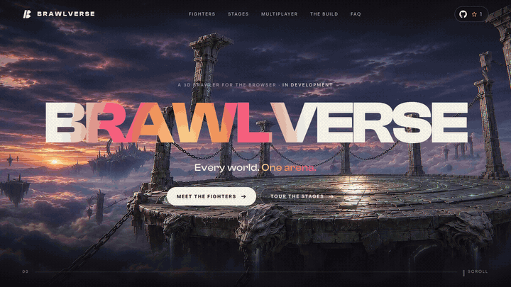</a>

<sub>↑ The landing page hero, scrubbed by scroll. <a href="assets/hero-scroll.mp4">Watch it as MP4</a> or <a href="https://brawlverse.vercel.app">scroll it yourself</a>.</sub>

</div>

---

## ✦ What is this?

Brawlverse is a platform fighter you play **in a browser tab**: four fighters, floating arenas, knock your friend off the stage. This repo holds the cinematic landing page that launches the project, built the way AAA game sites are — a scroll-driven trailer, real-time 3D characters and shader-driven stage reveals — while the game itself is built in the open.

| | |
|:--|:--|
| 🎬 **Scroll-driven trailer** | A 128-frame cinematic clip scrubbed frame-by-frame by your scroll, rendered on a WebGL shader with RGB split, embers and letterbox bars. |
| 🧍 **Real 3D fighters** | Rigged, animated characters on a turntable — drag to spin them, scroll to switch. Environment reflections, coloured rim lights, a glowing arena disc. |
| 🌋 **Living stages** | Every stage still gets an AI depth map, so the shader moves near and far layers separately — the art reads as a 3D set, not a JPEG. |
| ✨ **Small, crafted details** | A cursor-following light in the titles, letters that rise with scroll, a star count that counts up, a closing video that only plays when on screen. |
| ⚡ **Fast** | Frames stream in coarse-to-fine, renderers sleep off-screen, pixel ratio is capped on weaker devices, and everything ships from Vercel's edge with long-lived caching. |
| ♿ **Respectful** | Honours `prefers-reduced-motion`, falls back to images when WebGL isn't available, and keeps all text real, selectable HTML. |

---

## 🥊 The roster

<p align="center">
  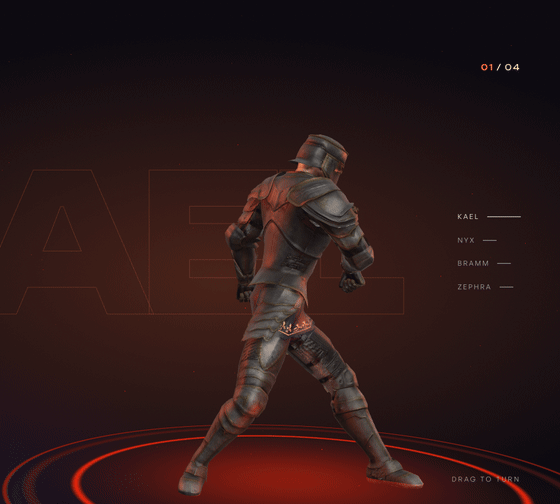
</p>

<table>
  <tr>
    <td width="50%">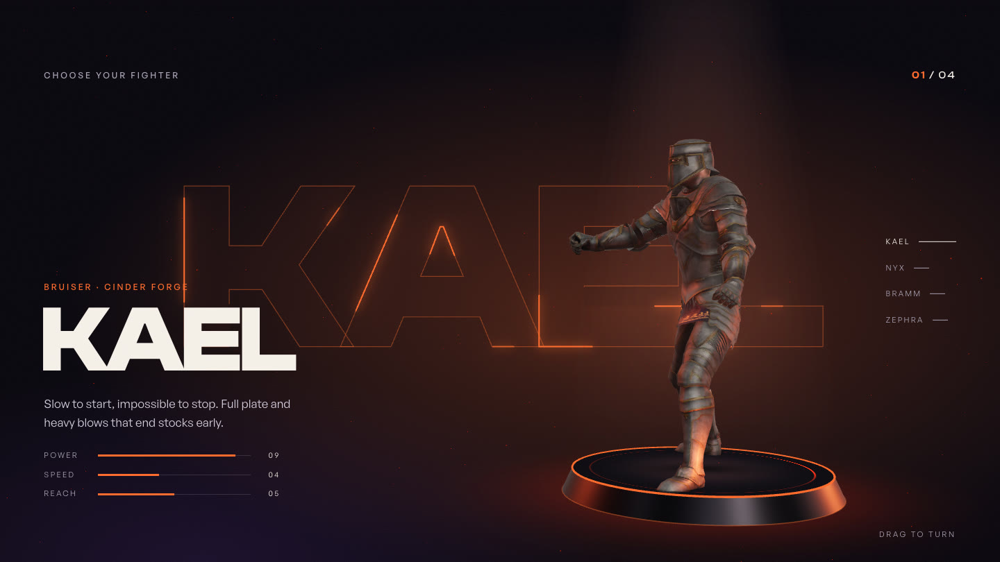<br /><b>Kael</b> — Bruiser · Cinder Forge<br /><sub>Slow to start, impossible to stop. Full plate and heavy blows that end stocks early.</sub></td>
    <td width="50%">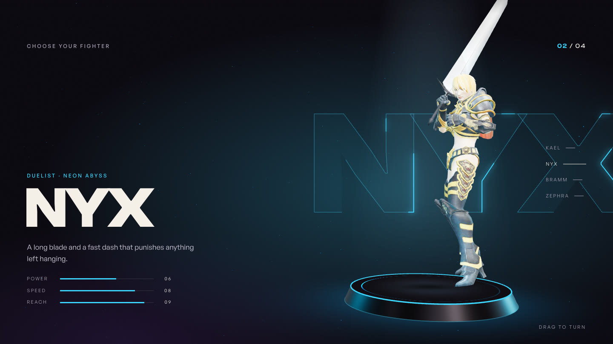<br /><b>Nyx</b> — Duelist · Neon Abyss<br /><sub>A long blade and a fast dash that punishes anything left hanging.</sub></td>
  </tr>
  <tr>
    <td width="50%">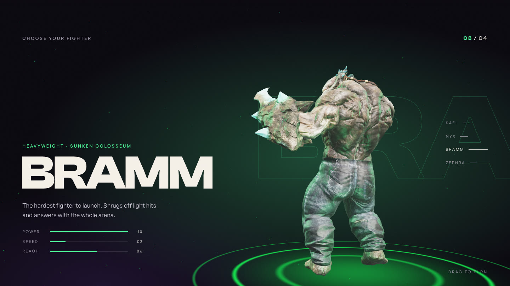<br /><b>Bramm</b> — Heavyweight · Sunken Colosseum<br /><sub>The hardest fighter to launch. Shrugs off light hits and answers with the whole arena.</sub></td>
    <td width="50%">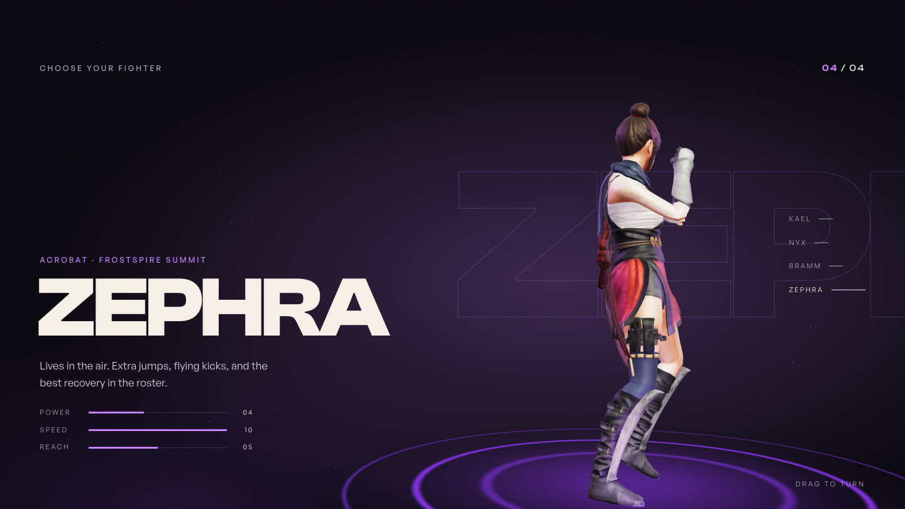<br /><b>Zephra</b> — Acrobat · Frostspire Summit<br /><sub>Lives in the air. Extra jumps, flying kicks, and the best recovery in the roster.</sub></td>
  </tr>
</table>

## 🏟 The stages

<table>
  <tr>
    <td width="50%">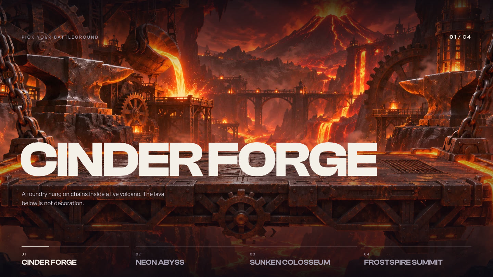<br /><b>Cinder Forge</b><br /><sub>A foundry hung on chains inside a live volcano.</sub></td>
    <td width="50%">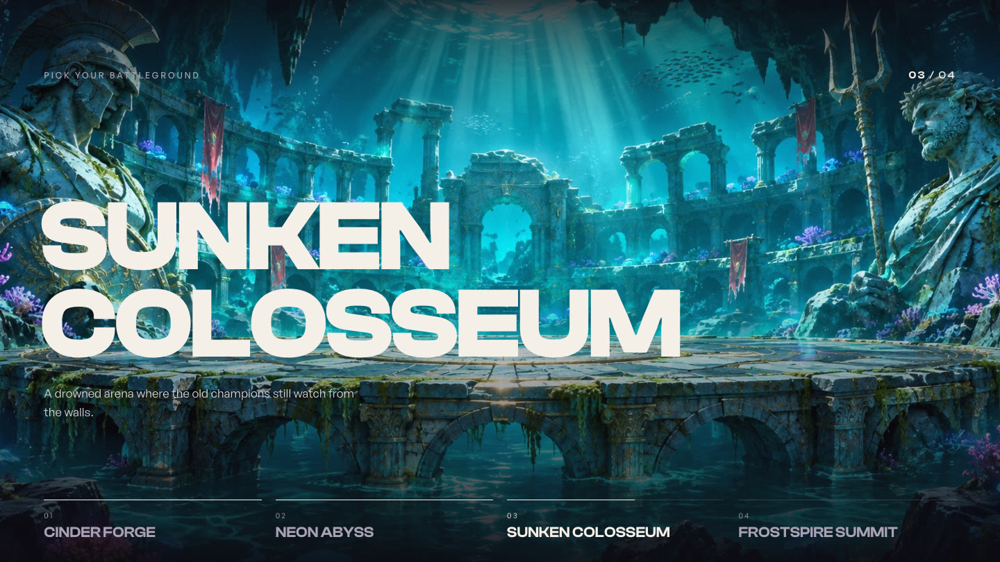<br /><b>Sunken Colosseum</b><br /><sub>A drowned arena where the old champions still watch from the walls.</sub></td>
  </tr>
</table>

Plus **Neon Abyss** and **Frostspire Summit** — [see all four live](https://brawlverse.vercel.app/#stages).

<details>
<summary><b>More of the page</b> (multiplayer, FAQ, closing, footer)</summary>
<br />

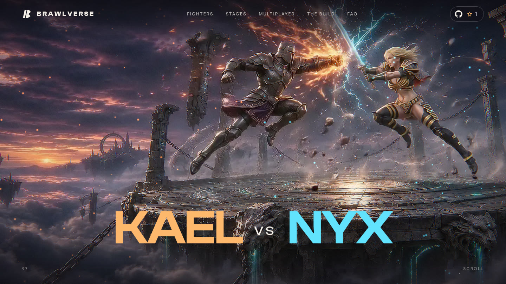

| | |
|:--:|:--:|
| 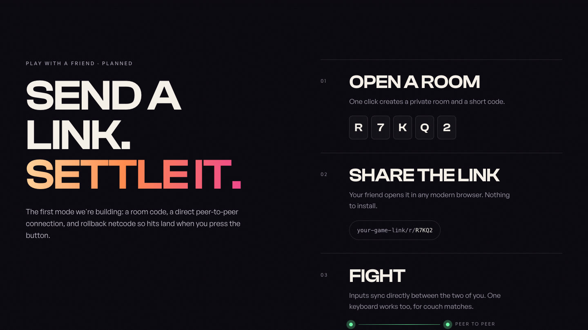 | 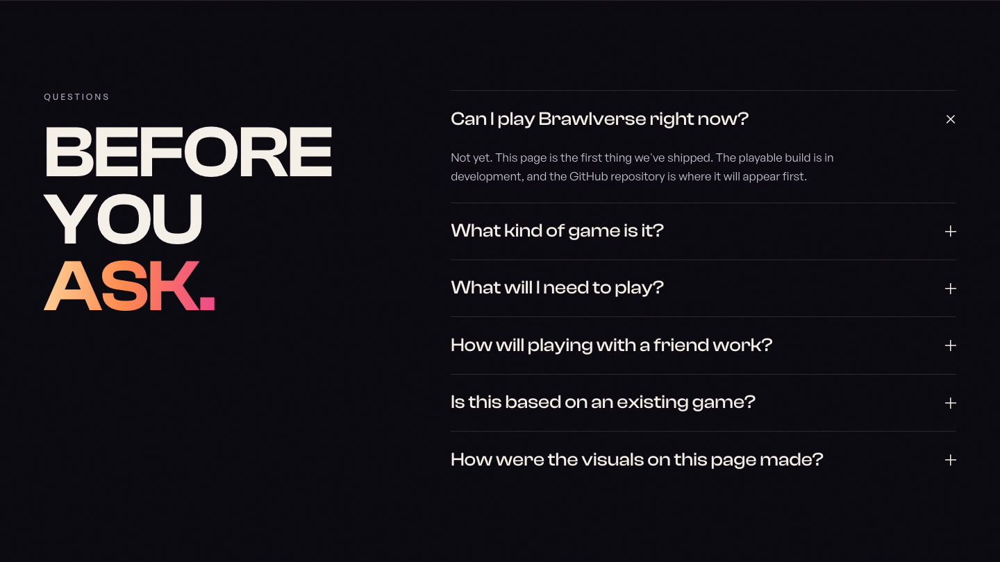 |
| **Send a link. Settle it.** | **Before you ask.** |
| 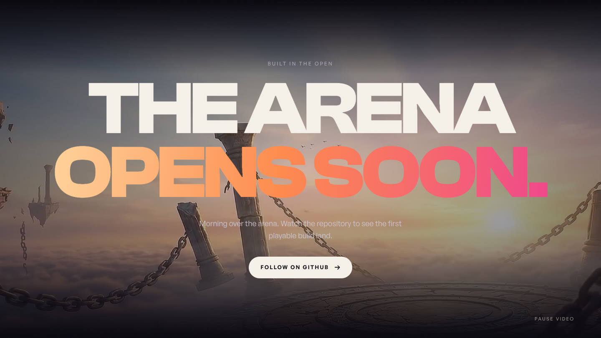 | 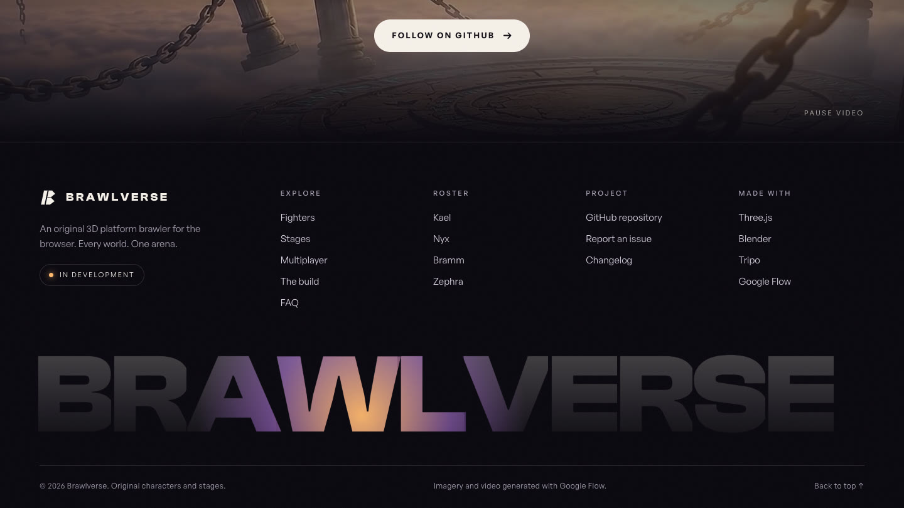 |
| **The arena opens soon** — over a looping morning-arena video | **Footer** — the wordmark rises in and catches the cursor light |

</details>

---

## 🚀 Quick start

You need **Node.js 20+**.

```bash
git clone https://github.com/satiricalguru/Brawlverse.git
cd Brawlverse
npm install
npm run dev
```

Open the URL Vite prints (default `http://localhost:5173`) and scroll.

| Command | What it does |
|:--|:--|
| `npm run dev` | Dev server with hot reload |
| `npm run build` | Production build into `dist/` |
| `npm run preview` | Serve the production build locally |

> [!TIP]
> The page is tuned for desktop, but it runs on phones too — weaker devices get a lighter render path automatically.

---

## 🛠 How it's built

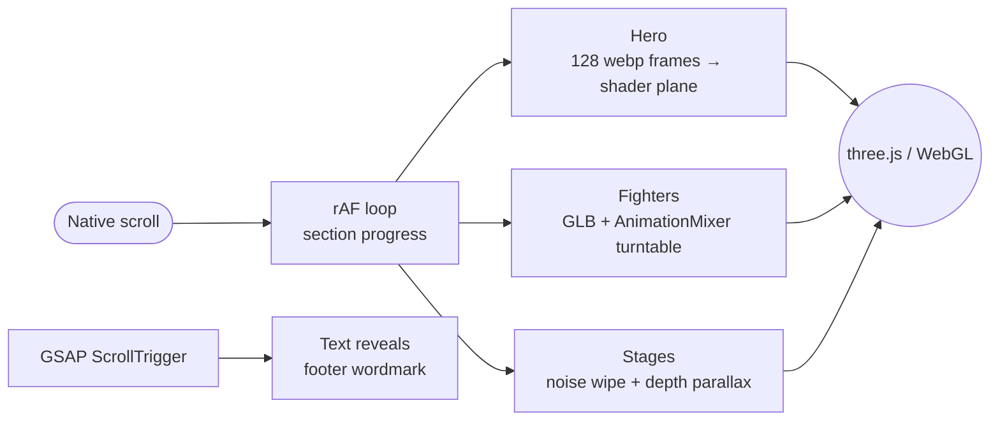

| Piece | File | Notes |
|:--|:--|:--|
| Scroll + sections | [`src/main.js`](src/main.js) | One `requestAnimationFrame` loop reads native scroll for every sticky section; GSAP handles reveals. |
| Hero trailer | [`src/hero.js`](src/hero.js) | Frame loader (poster → every 8th frame → the rest) feeding a shader with chromatic split, embers and letterbox. |
| 3D fighters | [`src/fighters3d.js`](src/fighters3d.js) | GLTFLoader, PMREM room environment, key + coloured rim lights, drag-to-spin with inertia. |
| Stages | [`src/stages.js`](src/stages.js) | Two-texture fbm noise wipe with a hot edge; depth maps drive per-pixel parallax. |
| Asset tooling | [`tools/`](tools) | Headless Blender scripts: FBX → optimised GLB with NLA animation tracks, and reference renders. |

### The asset pipeline

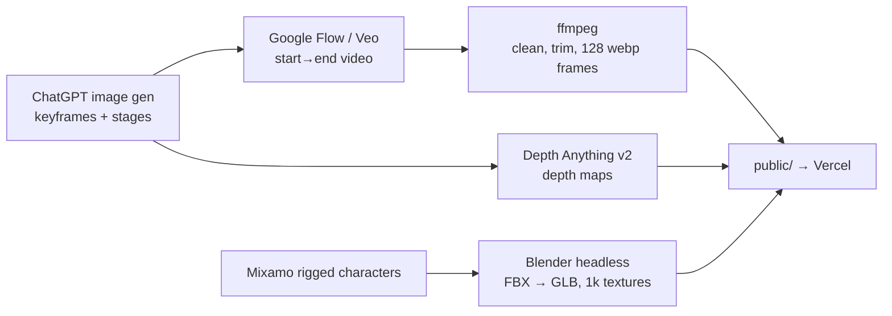

---

## 🗺 Roadmap

- [x] Cinematic landing page with scroll trailer, 3D roster and stage reveals
- [x] Deploy on Vercel
- [ ] Playable movement prototype: run, jump, double-jump, ledge grab
- [ ] Hit, knockback and launch-percentage system
- [ ] Peer-to-peer rooms over WebRTC with rollback netcode
- [ ] Signature moves for all four fighters
- [ ] First public playable build

Watch or ⭐ the repo to see the playable build land.

## 🤝 Contributing

Issues and ideas are welcome — open one at [github.com/satiricalguru/Brawlverse/issues](https://github.com/satiricalguru/Brawlverse/issues). For code changes, fork, branch, and open a pull request with a short description and a screenshot or clip if it's visual.

## 👥 Contributors

Brawlverse is built in the open. Thanks to everyone who has pushed to this repo:

- **[@Mxhi-04](https://github.com/Mxhi-04)** — documentation, asset references and repo upkeep
- **[@satiricalguru](https://github.com/satiricalguru)** — direction, design and the build
- **[Copilot](https://github.com/apps/copilot-swe-agent)**, **[Cursor Agent](https://github.com/cursoragent)** and **[Codex](https://github.com/codex)** — agent-assisted code, refactors and tooling
- **[dependabot[bot]](https://github.com/apps/dependabot)** and **[github-actions[bot]](https://github.com/actions)** — dependency bumps and CI

Every commit is attributed, so the full list also lives in the [contributors graph](https://github.com/satiricalguru/Brawlverse/graphs/contributors).

## 🙏 Credits

- **Characters:** rigged models and animations from [Adobe Mixamo](https://www.mixamo.com).
- **Imagery and video:** generated with ChatGPT image generation and Google Flow (Veo).
- **Depth maps:** [Depth Anything V2](https://github.com/DepthAnything/Depth-Anything-V2) via Transformers.js.
- **Fonts:** Clash Display and General Sans from [Fontshare](https://www.fontshare.com).
- **Built with:** [three.js](https://threejs.org), [GSAP](https://gsap.com), [Vite](https://vite.dev), [Blender](https://www.blender.org).

Brawlverse is an original project: its characters, stages and story are its own and it is not affiliated with any other game.

---

<div align="center">

**If the trailer made you want to throw hands, [give it a ⭐](https://github.com/satiricalguru/Brawlverse)** — it's how we know to keep going.

<sub><a href="#brawlverse">↑ Back to top</a></sub>

</div>
