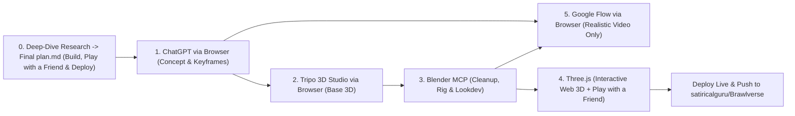

# Brawlverse — 3D Game & Cinematic Production Plan

> **Repository:** [`satiricalguru/Brawlverse`](https://github.com/satiricalguru/Brawlverse) (`https://github.com/satiricalguru/Brawlverse.git`)  
> **Local Workspace:** `/Users/jatin/Projects/Super Smash Bros`  
> **Description:** `A next-gen 3D web brawler powered by Three.js, Blender MCP & Tripo 3D Studio assets, paired with high-detail realistic cinematics from Google Flow.`

> [!IMPORTANT]
> **Execution Instructions, Browser Access & Quality Guardrails**
> - **Mandatory First Step — Deep-Dive Research & `Final plan.md`:** Before writing game code or generating assets, perform deep-dive research on how **Brawlverse** will be built—explicitly covering **Play with a Friend** multiplayer features and **where/how it will be deployed**—and create **`Final plan.md`** with the complete implementation blueprint.
> - **Use My Browser Freely:** You are authorized to use my browser directly to do whatever is required across **ChatGPT**, **Tripo 3D Studio**, **Google Flow**, and **GitHub**.
> - **Video Generation (Exclusive):** Use **Google Flow only** for all video generation — every video must be **realistic, high-graphics, and high-detail**.
> - **Image Generation:** Open and use **ChatGPT** for concept art, character/stage references, textures, and keyframes.
> - **3D Workflow:** Generate base meshes in **[Tripo 3D Studio](https://studio.tripo3d.ai/)**, refine/rig/light via **Blender MCP**, and build the playable runtime in **Three.js**.

---

## 1. Required First Phase — Deep-Dive Research & `Final plan.md`

Before starting development, run a deep-dive research pass and compile the complete architecture and execution blueprint into **`Final plan.md`**:

1. **Build Architecture (Deep Research):**
   - Research and design how **Brawlverse** will be built end-to-end across **Three.js**, **Blender MCP**, **Tripo 3D Studio**, **ChatGPT**, and **Google Flow**.
   - Define the core game loop, physics/combat mechanics, character & stage loading pipeline (`.glb`/`.gltf`), VFX/audio, UI/HUD, and performance strategy.
2. **Multiplayer — Play with a Friend:**
   - Research and include **Play with a Friend** features in the plan (e.g., shareable room/invite links or codes, friend lobbies, real-time networking/state sync, and local/online friend play options).
3. **Deployment Strategy:**
   - Research and specify **where and how Brawlverse will be deployed** (frontend hosting/CDN, any multiplayer server/signaling backend, 3D asset & cinematic media delivery, environment configuration, and deployment workflow).
4. **Deliverable:**
   - Write the finalized, research-backed blueprint to **`Final plan.md`** in the project root (`/Users/jatin/Projects/Super Smash Bros/Final plan.md`) before proceeding to build.

---

## 2. Core Stack & Responsibilities

| Layer | Tool / Platform | Execution Mode | Role in Pipeline | Link / Access |
| :--- | :--- | :--- | :--- | :--- |
| **Image Generation** | **ChatGPT** | Browser use | Concept art, turnarounds, UI/stage artwork, and cinematic reference frames | Open in browser |
| **AI 3D Generation** | **Tripo 3D Studio** | Browser use | Text-to-3D and image-to-3D base mesh generation for fighters, props, and stages | [studio.tripo3d.ai](https://studio.tripo3d.ai/) |
| **3D Refinement & Lookdev** | **Blender MCP** | Blender MCP server | Mesh cleanup, retopology, rigging, PBR shading, lighting, camera staging, and `.glb`/`.gltf` export | Local Blender MCP |
| **Interactive Web Engine** | **Three.js** | Local codebase | Real-time playable 3D browser runtime, shaders, lighting, camera, multiplayer (`Play with a Friend`), and gameplay HUD | WebGL / WebGPU client |
| **Video Generation** | **Google Flow** *(Exclusive)* | Browser use | Photorealistic, high-graphics, detailed trailers, reveals, and cutscenes | Google Flow *(video only)* |

---

## 3. Production Pipeline

---

## 4. Step-by-Step Workflow

### Step 0 — Deep-Dive Research & Final Blueprint (`Final plan.md`)
- Conduct deep-dive research on how **Brawlverse** will be built from scratch.
- Plan and integrate **Play with a Friend** multiplayer features and **where/how the project will be deployed**.
- Output the full research and execution specification into **`Final plan.md`** before moving to production steps.

### Step 1 — Concept & Image Generation (`ChatGPT` via Browser)
- Open **ChatGPT** in my browser to generate cohesive style guides, character/stage concepts, and high-resolution reference stills.
- Export clean character turnarounds (for 3D generation) and dramatic environment stills (for lighting lookdev and video keyframes).

### Step 2 — Base 3D Modeling (`Tripo 3D Studio` via Browser)
- Upload ChatGPT concept images (or prompt directly) in **[Tripo 3D Studio](https://studio.tripo3d.ai/)** via my browser to generate initial 3D fighter, prop, and stage geometry.
- Download raw meshes and textures into the project pipeline.

### Step 3 — 3D Cleanup, Rigging & Scene Staging (`Blender MCP`)
- Drive **Blender** directly through **Blender MCP** for asset preparation and look development:
  - Clean geometry, normalize scale/pivots, and refine PBR materials and lighting.
  - Rig characters, pose/animate fighters, and assemble full battle stages.
  - Export optimized **`.glb` / `.gltf`** bundles for **Three.js**.
  - Render high-detail camera stills to use as reference frames for **Google Flow**.

### Step 4 — Real-Time 3D Engine & Multiplayer (`Three.js`)
- Load the Blender-exported `.glb`/`.gltf` characters and stages into **Three.js**.
- Build real-time lighting, shadows, tone mapping, post-processing, dynamic camera tracking, interactive gameplay mechanics, and **Play with a Friend** multiplayer support, ready for deployment to the target platform defined in `Final plan.md`.

### Step 5 — Realistic High-Graphics Video (`Google Flow` via Browser Only)
- Use **Google Flow exclusively** via my browser for all video generation — no alternative video generators.
- Feed high-detail stills (from **ChatGPT** / **Blender MCP**) and camera/motion prompts to produce **realistic, high-graphics, high-detail** cinematics and reveal trailers.

---

## 5. Action Checklist

- [ ] **Deep-Dive Research (`Final plan.md`):** Research how to build **Brawlverse**, including **Play with a Friend** multiplayer features and **where/how to deploy**, and create `Final plan.md`.
- [ ] **ChatGPT (Browser):** Generate fighter & stage concept sheets plus keyframe stills.
- [ ] **Tripo 3D Studio (Browser):** Generate base 3D meshes at [studio.tripo3d.ai](https://studio.tripo3d.ai/).
- [ ] **Blender MCP:** Clean meshes, rig fighters, set up PBR shaders/lighting, and export `.glb` files.
- [ ] **Three.js:** Build the interactive 3D arena, asset loaders, shaders, gameplay loop, and **Play with a Friend** mode.
- [ ] **Google Flow (Browser):** Generate realistic, high-graphics, detailed video sequences strictly via Google Flow.
- [ ] **Deploy:** Deploy the live **Brawlverse** build (and any multiplayer backend) to the chosen platform documented in `Final plan.md`.
